# dev-social-network-bd

Repositorio para base de datos para proyecto de fábrica escuela de Red Social para desarrolladores.

## Integrantes
- Juan Esteban Tobón Martínez.
- Juan Camilo Mona Lujan.
- Valentina Garro Ramírez.
- Laura Katherine Henao Areiza.
- Edgar Andrés Garzón Marín.
- Diego Alexander Sánchez

## Objetivo general

Desarrollar una red social orientada a desarrolladores donde puedan compartir proyectos, discutir tecnologías y encontrar colaboradores.

## Objetivos específicos

- Permitir el registro y el inicio de sesión de usuarios en la red social
- Creación de perfiles técnicos
- Publicación de proyectos y repositorios de código con las demás comunidades de software
- Creación de discusiones sobre tecnologías y herramientas
- Creación de un sistema de comentarios e interacción entre usuarios
- Permitir la comunicación a través de mensajería instantánea entre los miembros de la comunidad
- Generación de reportes sobre la actividad y crecimiento de la comunidad

---

# Documentación del Sprint 2 · Diseño de base de datos

Red social para desarrolladores (CodeF@ctory): perfiles técnicos, publicación de proyectos, discusiones por tecnología, comentarios, seguidores, likes y mensajería privada. Motor: PostgreSQL 14 o superior.

## Contenido del repositorio

| Archivo | Para qué sirve | Sección |
|---|---|---|
| `README.md` | Documentación del sprint (este archivo) | todas |
| `schema.sql` | Script de estructuras: 15 tablas, claves, restricciones e índices | 3 |
| `seed.sql` | Datos semilla de demostración (opcional) | 3, 4 |
| `verificacion.sql` | Comprueba lo que creó `schema.sql` (V1–V5) | 3 |
| `consultas.sql` | Consultas PC01–PC14 (preguntas clave) y C01–C27 (por historia de usuario) | 4 |
| `seguridad.sql` | Roles y privilegios (GRANT/REVOKE) | 6 |
| `verificacion_seguridad.sql` | Comprueba roles y privilegios (S1–S4) | 6 |
| `pruebas_seguridad.sql` | 15 pruebas de acceso permitido y denegado con `SET ROLE` | 6 |
| `carga_sintetica.sql` | Genera datos a escala del mes 12 para validar la estimación de volumen | 5 |
| `docs/analisis-almacenamiento.md` | Análisis de almacenamiento, costo y optimización algebraica | 7 |
| `docs/MER refinado.md` | MER en Mermaid (mismo diagrama de la sección 1) | 1 |
| `docs/RELACIONES.md` | Análisis de dependencias funcionales del Sprint 1 (historial) | 1 |
| `docs/historico/DDL_sprint1.sql` | Borrador del Sprint 1, solo como historial | — |

### Orden de ejecución sobre una base PostgreSQL vacía

```bash
createdb codefactory_s2
for f in schema verificacion seed consultas seguridad verificacion_seguridad pruebas_seguridad; do
  psql -d codefactory_s2 -f $f.sql
done
```

`pruebas_seguridad.sql` muestra 10 mensajes `permission denied`: son los accesos que **deben** ser denegados. `carga_sintetica.sql` se ejecuta aparte, sobre otra base creada solo con `schema.sql`.

---

## 1. MER refinado

MER del Sprint 2 con las 15 entidades, sus atributos, llaves (PK, FK, UK) y cardinalidades. Es el mismo diagrama de `docs/MER refinado.md` y coincide con `schema.sql`.

```mermaid
erDiagram
    USUARIOS ||--o| CREDENCIALES : "tiene"
    USUARIOS ||--o| PERFILES_USUARIO : "tiene"
    USUARIOS ||--o{ PROYECTOS : "publica"
    USUARIOS ||--o{ DISCUSIONES : "crea"
    USUARIOS ||--o{ INTERACCION_DISCUSION : "comenta"
    USUARIOS ||--o{ INTERACCION_PROYECTO : "comenta"
    USUARIOS ||--o{ LIKES_PROYECTO : "da"
    USUARIOS ||--o{ SEGUIDORES : "sigue"
    USUARIOS ||--o{ SEGUIDORES : "es seguido"
    USUARIOS ||--o{ CONVERSACIONES : "participa"
    USUARIOS ||--o{ MENSAJES_PRIVADOS : "envía"

    PERFILES_USUARIO ||--o{ ENLACES_EXTERNOS : "tiene"
    PERFILES_USUARIO ||--o{ HABILIDADES : "tiene"
    TECNOLOGIAS ||--o{ HABILIDADES : "es habilidad de"

    PROYECTOS ||--o{ PROYECTO_TECNOLOGIAS : "usa"
    TECNOLOGIAS ||--o{ PROYECTO_TECNOLOGIAS : "se usa en"
    PROYECTOS ||--o{ LIKES_PROYECTO : "recibe"
    PROYECTOS ||--o{ INTERACCION_PROYECTO : "recibe"

    TECNOLOGIAS ||--o{ DISCUSIONES : "agrupa"
    DISCUSIONES ||--o{ INTERACCION_DISCUSION : "recibe"

    CONVERSACIONES ||--o{ MENSAJES_PRIVADOS : "contiene"

    USUARIOS {
        uuid id PK
        varchar username UK
        varchar nombre
        varchar apellido
        varchar email UK
        timestamptz fecha_registro
    }
    CREDENCIALES {
        uuid id PK
        uuid usuario_id FK, UK
        varchar tipo
        varchar password_hash
        varchar proveedor_id_externo
        int intentos_fallidos
        timestamptz bloqueado_hasta
    }
    PERFILES_USUARIO {
        uuid id PK
        uuid id_usuario FK, UK
        timestamptz fecha_creacion
        varchar bio
        numeric nivel_completado
        varchar enlace_portafolio
        int anio_inicio_dev
        varchar nivel
    }
    ENLACES_EXTERNOS {
        uuid id PK
        uuid id_perfil FK
        varchar nombre_enlace
        varchar url_enlace
    }
    TECNOLOGIAS {
        uuid id PK
        varchar nombre_tecnologia UK
        varchar tipo
    }
    HABILIDADES {
        uuid id_perfil PK, FK
        uuid id_tecnologia PK, FK
    }
    PROYECTOS {
        uuid id PK
        uuid usuario_id FK
        varchar titulo
        varchar descripcion
        varchar repositorio_url
        timestamptz fecha_creacion
        timestamptz ultima_actualizacion
    }
    PROYECTO_TECNOLOGIAS {
        uuid id_proyecto PK, FK
        uuid id_tecnologia PK, FK
    }
    LIKES_PROYECTO {
        uuid id_proyecto PK, FK
        uuid id_usuario PK, FK
        timestamptz fecha_creacion
    }
    INTERACCION_PROYECTO {
        uuid id PK
        uuid id_proyecto FK
        uuid id_usuario FK
        text comentario
        timestamptz fecha_creacion
    }
    SEGUIDORES {
        uuid id_seguidor PK, FK
        uuid id_seguido PK, FK
        timestamptz fecha_creacion
    }
    DISCUSIONES {
        uuid id PK
        uuid autor_id FK
        uuid id_tecnologia FK
        varchar titulo
        text contenido
        varchar estado
        timestamptz fecha_creacion
        timestamptz ultima_actualizacion
    }
    INTERACCION_DISCUSION {
        uuid id PK
        uuid id_discusion FK
        uuid id_usuario FK
        text comentario
        timestamptz fecha_creacion
    }
    CONVERSACIONES {
        uuid id PK
        uuid id_participante_uno FK
        uuid id_participante_dos FK
        timestamptz fecha_creacion
    }
    MENSAJES_PRIVADOS {
        uuid id PK
        uuid id_conversacion FK
        uuid remitente_id FK
        uuid destinatario_id FK
        varchar contenido
        timestamptz fecha_envio
    }
```



<!-- PENDIENTE (Esteban): descomentar al subir docs/img/MER_refinado_diagrama.png
 Imagen del mismo diagrama, agrupada por módulos: 
-->

### Cardinalidades

| Relación | Cardinalidad | Justificación |
|---|---|---|
| usuarios — credenciales | 1 a 0..1 | Cada usuario tiene una credencial |
| usuarios — perfiles_usuario | 1 a 0..1 | Cada usuario tiene un único perfil técnico |
| perfiles_usuario — enlaces_externos | 1 a N | Varios enlaces por perfil (GitHub, LinkedIn) |
| perfiles_usuario — tecnologias (habilidades) | N a M | Se resuelve con la tabla `habilidades` |
| usuarios — proyectos | 1 a N | Un usuario publica varios proyectos |
| proyectos — tecnologias (proyecto_tecnologias) | N a M | Se resuelve con `proyecto_tecnologias` |
| usuarios — discusiones | 1 a N | Un usuario crea varias discusiones |
| tecnologias — discusiones | 1 a N | Cada discusión pertenece a una tecnología |
| discusiones — interaccion_discusion | 1 a N | Comentarios de una discusión |
| proyectos — interaccion_proyecto | 1 a N | Comentarios de un proyecto |
| usuarios — interaccion_discusion / interaccion_proyecto | 1 a N | Autor de cada comentario |
| usuarios — usuarios (seguidores) | N a M reflexiva | Quién sigue a quién; dos claves hacia `usuarios` |
| proyectos — usuarios (likes_proyecto) | N a M | Un like por usuario y proyecto |
| usuarios — conversaciones | N a M (2 participantes) | Una conversación por pareja de usuarios |
| conversaciones — mensajes_privados | 1 a N | Mensajes de una conversación |
| usuarios — mensajes_privados | 1 a N (remitente y destinatario) | Dos claves hacia `usuarios` |

### Cambios del MER frente al Sprint 1

| Elemento | Cambio | Historia |
|---|---|---|
| `seguidores` | Entidad nueva (N:M reflexiva usuarios–usuarios) | HU005 |
| `likes_proyecto` | Entidad nueva (N:M usuarios–proyectos) | HU010 |
| `interaccion_proyecto` | Entidad nueva: comentarios de proyectos | HU013 |
| `conversaciones`, `mensajes_privados` | Entidades nuevas: mensajería privada | HU017 |
| `habilidades` | La relación N:M perfil–tecnología pasa a entidad con PK compuesta | HU003 |
| `discusiones` | Atributos nuevos: `estado`, `fecha_creacion`, `ultima_actualizacion` | HU011, HU012 |
| `interaccion_discusion` | Atributo nuevo: `fecha_creacion` | HU011 |
| `proyectos` | Atributo nuevo: `ultima_actualizacion` | HU007 |
| `perfiles_usuario` | Atributo nuevo: `fecha_creacion` | HU003 |

El resto de entidades (`usuarios`, `credenciales`, `enlaces_externos`, `tecnologias`, `proyecto_tecnologias`) no cambia.

---

## 2. Modelo físico completo (claves y restricciones)

Documentado a partir del catálogo de PostgreSQL después de ejecutar `schema.sql` (por eso coincide con el script) (15 tablas, 73 columnas, 15 PK, 23 FK, 6 UNIQUE, 19 CHECK y 13 índices).

### Convenciones

- Tablas en plural, snake_case y español; claves primarias `id UUID DEFAULT gen_random_uuid()`; en tablas N:M, PK compuesta por las claves foráneas.
- Fechas `TIMESTAMPTZ DEFAULT CURRENT_TIMESTAMP`; dominios cerrados con `CHECK ... IN (...)`; prefijos `chk_`, `uq_`, `idx_`.
- Borrado: `ON DELETE CASCADE` salvo `discusiones.id_tecnologia` (protege el contenido de la comunidad).

### Resumen por tabla

| # | Tabla | Tipo de entidad | Col. | PK | FK | UQ | CHK | HU |
|---|---|---|---|---|---|---|---|---|
| 1 | `usuarios` | Fuerte | 6 | 1 | 0 | 2 | 1 | HU001 |
| 2 | `credenciales` | Dependiente (1:1) | 7 | 1 | 1 | 1 | 3 | HU001, HU002 |
| 3 | `perfiles_usuario` | Dependiente (1:1) | 8 | 1 | 1 | 1 | 2 | HU003 |
| 4 | `enlaces_externos` | Dependiente | 4 | 1 | 1 | 0 | 0 | HU003 |
| 5 | `tecnologias` | Catálogo | 3 | 1 | 0 | 1 | 1 | HU003, HU007, HU011 |
| 6 | `habilidades` | Asociativa N:M | 2 | 1 | 2 | 0 | 0 | HU003 |
| 7 | `proyectos` | Fuerte | 7 | 1 | 1 | 0 | 3 | HU007 |
| 8 | `proyecto_tecnologias` | Asociativa N:M | 2 | 1 | 2 | 0 | 0 | HU007 |
| 9 | `discusiones` | Fuerte | 8 | 1 | 2 | 0 | 3 | HU011, HU012 |
| 10 | `interaccion_discusion` | Dependiente | 5 | 1 | 2 | 0 | 1 | HU011 |
| 11 | `interaccion_proyecto` | Dependiente | 5 | 1 | 2 | 0 | 1 | HU013 |
| 12 | `seguidores` | Asociativa N:M (reflexiva) | 3 | 1 | 2 | 0 | 1 | HU005 |
| 13 | `likes_proyecto` | Asociativa N:M | 3 | 1 | 2 | 0 | 0 | HU010 |
| 14 | `conversaciones` | Fuerte | 4 | 1 | 2 | 1 | 1 | HU017 |
| 15 | `mensajes_privados` | Dependiente | 6 | 1 | 3 | 0 | 2 | HU017 |

### Diccionario de datos

#### `usuarios`

Cuenta del desarrollador (correo y username únicos). Historias: HU001.

| Columna | Tipo | Nulo | Por defecto | Clave / restricciones | Descripción |
|---|---|---|---|---|---|
| `id` | UUID | NO | gen_random_uuid() | PK | Identificador único del usuario (UUID generado por la base). |
| `nombre` | VARCHAR(100) | SÍ | — | — | Nombre de pila. |
| `apellido` | VARCHAR(100) | SÍ | — | — | Apellido. |
| `username` | VARCHAR(50) | SÍ | — | UNIQUE | Nombre público único (HU001). Admite nulo; PostgreSQL no considera duplicados los nulos. |
| `email` | VARCHAR(255) | NO | — | chk_usuario_email<br>UNIQUE | Correo de acceso: único, obligatorio y no vacío (HU001). |
| `fecha_registro` | TIMESTAMPTZ | NO | CURRENT_TIMESTAMP | — | Instante en que se creó la cuenta (UTC). |

- `chk_usuario_email`: El correo no puede estar vacío. (HU001).

#### `credenciales`

Credencial de acceso 1:1; guarda intentos fallidos y bloqueo (3 intentos, 5 min). Historias: HU001, HU002.

| Columna | Tipo | Nulo | Por defecto | Clave / restricciones | Descripción |
|---|---|---|---|---|---|
| `id` | UUID | NO | gen_random_uuid() | PK | Identificador de la credencial. |
| `usuario_id` | UUID | NO | — | FK → usuarios(id) · CASCADE<br>UNIQUE | Usuario dueño de la credencial. UNIQUE implementa la relación 1 a 1. |
| `tipo` | VARCHAR(30) | NO | 'LOCAL' | chk_credencial_local<br>chk_credencial_tipo | Mecanismo de autenticación: LOCAL u OAUTH_<proveedor>. |
| `password_hash` | VARCHAR(255) | SÍ | — | chk_credencial_local | Hash de la contraseña (BCrypt); obligatorio cuando tipo = LOCAL. |
| `proveedor_id_externo` | VARCHAR(255) | SÍ | — | — | Identificador del usuario en el proveedor OAuth, si aplica. |
| `intentos_fallidos` | INT | NO | 0 | chk_credencial_intentos | Inicios de sesión fallidos consecutivos (HU002). |
| `bloqueado_hasta` | TIMESTAMPTZ | SÍ | — | — | Instante hasta el que la cuenta está bloqueada; nulo si no lo está (HU002: 3 intentos, 5 minutos). |

- `chk_credencial_intentos`: intentos_fallidos nunca es negativo. (HU002).
- `chk_credencial_local`: Una credencial LOCAL exige password_hash. (HU001).
- `chk_credencial_tipo`: tipo es LOCAL o empieza por OAUTH_. (HU001).

#### `perfiles_usuario`

Perfil técnico 1:1: bio, nivel, años de experiencia. Historias: HU003.

| Columna | Tipo | Nulo | Por defecto | Clave / restricciones | Descripción |
|---|---|---|---|---|---|
| `id` | UUID | NO | gen_random_uuid() | PK | Identificador del perfil. |
| `id_usuario` | UUID | NO | — | FK → usuarios(id) · CASCADE<br>UNIQUE | Usuario dueño del perfil. UNIQUE implementa la relación 1 a 1. |
| `fecha_creacion` | TIMESTAMPTZ | NO | CURRENT_TIMESTAMP | — | Instante de creación del perfil. |
| `bio` | VARCHAR(500) | SÍ | — | — | Presentación del usuario (máx. 500 caracteres). |
| `nivel_completado` | NUMERIC(5,2) | SÍ | 0 | chk_perfil_completado | Porcentaje de completitud del perfil (0 a 100). Dato derivado que se almacena (ver «Normalización»). |
| `enlace_portafolio` | VARCHAR(255) | SÍ | — | — | URL del portafolio personal. |
| `anio_inicio_dev` | INT | SÍ | — | — | Año en que empezó a programar; los años de experiencia (0 a 20, HU003) se calculan a partir de él. |
| `nivel` | VARCHAR(20) | NO | 'ENTRY' | chk_perfil_nivel | Nivel declarado: ENTRY, JUNIOR, MID o SENIOR. |

- `chk_perfil_completado`: nivel_completado entre 0 y 100. (HU003).
- `chk_perfil_nivel`: nivel ∈ {ENTRY, JUNIOR, MID, SENIOR}. (HU003).

#### `enlaces_externos`

Enlaces del perfil (GitHub, LinkedIn, portafolio). Historias: HU003.

| Columna | Tipo | Nulo | Por defecto | Clave / restricciones | Descripción |
|---|---|---|---|---|---|
| `id` | UUID | NO | gen_random_uuid() | PK | Identificador del enlace. |
| `id_perfil` | UUID | NO | — | FK → perfiles_usuario(id) · CASCADE | Perfil al que pertenece el enlace. |
| `nombre_enlace` | VARCHAR(50) | NO | — | — | Etiqueta del enlace (GITHUB, LINKEDIN, ...). |
| `url_enlace` | VARCHAR(255) | NO | — | — | URL del enlace. |

- Índice `idx_enlaces_perfil`: Enlaces de un perfil (C06).

#### `tecnologias`

Catálogo compartido de roles, lenguajes y frameworks. Historias: HU003, HU007, HU011.

| Columna | Tipo | Nulo | Por defecto | Clave / restricciones | Descripción |
|---|---|---|---|---|---|
| `id` | UUID | NO | gen_random_uuid() | PK | Identificador de la tecnología. |
| `nombre_tecnologia` | VARCHAR(100) | NO | — | UNIQUE | Nombre único dentro del catálogo (Java, React, ...). |
| `tipo` | VARCHAR(20) | NO | — | chk_tecnologia_tipo | Clasificación: ROL, LENGUAJE o FRAMEWORK. |

- `chk_tecnologia_tipo`: tipo ∈ {ROL, LENGUAJE, FRAMEWORK}. (HU003).

#### `habilidades`

N:M perfil–tecnología. Historias: HU003.

| Columna | Tipo | Nulo | Por defecto | Clave / restricciones | Descripción |
|---|---|---|---|---|---|
| `id_perfil` | UUID | NO | — | FK → perfiles_usuario(id) · CASCADE<br>PK (compuesta) | Perfil que declara la habilidad (parte de la PK). |
| `id_tecnologia` | UUID | NO | — | FK → tecnologias(id) · CASCADE<br>PK (compuesta) | Tecnología dominada (parte de la PK). |

- Índice `idx_habilidades_tecnologia`: Quién domina una tecnología (PC06, C08).

#### `proyectos`

Proyectos publicados con repositorio. Historias: HU007.

| Columna | Tipo | Nulo | Por defecto | Clave / restricciones | Descripción |
|---|---|---|---|---|---|
| `id` | UUID | NO | gen_random_uuid() | PK | Identificador del proyecto. |
| `usuario_id` | UUID | NO | — | FK → usuarios(id) · CASCADE | Autor del proyecto. |
| `titulo` | VARCHAR(50) | NO | — | chk_proyecto_titulo | Título (máx. 50 caracteres, no vacío). |
| `descripcion` | VARCHAR(250) | NO | — | chk_proyecto_descripcion | Descripción (máx. 250 caracteres, no vacía). |
| `repositorio_url` | VARCHAR(255) | SÍ | — | chk_proyecto_repositorio | URL del repositorio en GitHub, GitLab o Bitbucket; opcional. |
| `fecha_creacion` | TIMESTAMPTZ | NO | CURRENT_TIMESTAMP | — | Instante de publicación. |
| `ultima_actualizacion` | TIMESTAMPTZ | NO | CURRENT_TIMESTAMP | — | Última modificación; la actualiza la aplicación (no hay disparador). |

- `chk_proyecto_descripcion`: La descripción no puede estar vacía. (HU007).
- `chk_proyecto_repositorio`: URL de GitHub, GitLab o Bitbucket (o nula). (HU007).
- `chk_proyecto_titulo`: El título no puede estar vacío. (HU007).
- Índice `idx_proyectos_usuario`: Proyectos de un usuario (PC05, C10).

#### `proyecto_tecnologias`

N:M proyecto–tecnología. Historias: HU007.

| Columna | Tipo | Nulo | Por defecto | Clave / restricciones | Descripción |
|---|---|---|---|---|---|
| `id_proyecto` | UUID | NO | — | FK → proyectos(id) · CASCADE<br>PK (compuesta) | Proyecto (parte de la PK). |
| `id_tecnologia` | UUID | NO | — | FK → tecnologias(id) · CASCADE<br>PK (compuesta) | Tecnología usada (parte de la PK). |

- Índice `idx_proyecto_tecnologias_tecnologia`: Proyectos por tecnología (PC06, C11).

#### `discusiones`

Discusiones por tecnología con estado ABIERTA/RESUELTA. Historias: HU011, HU012.

| Columna | Tipo | Nulo | Por defecto | Clave / restricciones | Descripción |
|---|---|---|---|---|---|
| `id` | UUID | NO | gen_random_uuid() | PK | Identificador de la discusión. |
| `titulo` | VARCHAR(150) | NO | — | chk_discusion_titulo | Título (máx. 150 caracteres, no vacío). |
| `autor_id` | UUID | NO | — | FK → usuarios(id) · CASCADE | Usuario que creó la discusión. |
| `contenido` | TEXT | NO | — | chk_discusion_contenido | Mensaje inicial (no vacío). |
| `estado` | VARCHAR(20) | NO | 'ABIERTA' | chk_discusion_estado | ABIERTA o RESUELTA (HU012). |
| `fecha_creacion` | TIMESTAMPTZ | NO | CURRENT_TIMESTAMP | — | Instante de creación. |
| `ultima_actualizacion` | TIMESTAMPTZ | NO | CURRENT_TIMESTAMP | — | Última modificación; la actualiza la aplicación. |
| `id_tecnologia` | UUID | NO | — | FK → tecnologias(id) · NO ACTION | Tecnología bajo la que se clasifica (obligatoria). |

- `chk_discusion_contenido`: El contenido no puede estar vacío. (HU011).
- `chk_discusion_estado`: estado ∈ {ABIERTA, RESUELTA}. (HU011, HU012).
- `chk_discusion_titulo`: El título no puede estar vacío. (HU011).
- Índice `idx_discusiones_autor`: Discusiones por autor (PC11, C20).
- Índice `idx_discusiones_tecnologia`: Discusiones por tecnología (PC04, C13, C14).

#### `interaccion_discusion`

Comentarios sobre discusiones. Historias: HU011.

| Columna | Tipo | Nulo | Por defecto | Clave / restricciones | Descripción |
|---|---|---|---|---|---|
| `id` | UUID | NO | gen_random_uuid() | PK | Identificador del comentario. |
| `id_discusion` | UUID | NO | — | FK → discusiones(id) · CASCADE | Discusión comentada. |
| `id_usuario` | UUID | NO | — | FK → usuarios(id) · CASCADE | Autor del comentario. |
| `comentario` | TEXT | NO | — | chk_interaccion_disc_comentario | Texto del comentario (no vacío). |
| `fecha_creacion` | TIMESTAMPTZ | NO | CURRENT_TIMESTAMP | — | Instante de publicación. |

- `chk_interaccion_disc_comentario`: El comentario no puede estar vacío. (HU011).
- Índice `idx_interaccion_discusion`: Comentarios de una discusión.

#### `interaccion_proyecto`

Comentarios sobre proyectos (máx. 1000 caracteres). Historias: HU013.

| Columna | Tipo | Nulo | Por defecto | Clave / restricciones | Descripción |
|---|---|---|---|---|---|
| `id` | UUID | NO | gen_random_uuid() | PK | Identificador del comentario. |
| `id_proyecto` | UUID | NO | — | FK → proyectos(id) · CASCADE | Proyecto comentado. |
| `id_usuario` | UUID | NO | — | FK → usuarios(id) · CASCADE | Autor del comentario. |
| `comentario` | TEXT | NO | — | chk_interaccion_proy_comentario | Texto del comentario (no vacío, máx. 1000 caracteres; HU013). |
| `fecha_creacion` | TIMESTAMPTZ | NO | CURRENT_TIMESTAMP | — | Instante de publicación. |

- `chk_interaccion_proy_comentario`: Comentario no vacío y de máximo 1000 caracteres. (HU013).
- Índice `idx_interaccion_proyecto`: Comentarios de un proyecto (PC12, C22, C23).

#### `seguidores`

Relación seguidor–seguido entre usuarios. Historias: HU005.

| Columna | Tipo | Nulo | Por defecto | Clave / restricciones | Descripción |
|---|---|---|---|---|---|
| `id_seguidor` | UUID | NO | — | chk_seguidores_no_a_si_mismo<br>FK → usuarios(id) · CASCADE<br>PK (compuesta) | Usuario que sigue (parte de la PK). |
| `id_seguido` | UUID | NO | — | chk_seguidores_no_a_si_mismo<br>FK → usuarios(id) · CASCADE<br>PK (compuesta) | Usuario seguido (parte de la PK). |
| `fecha_creacion` | TIMESTAMPTZ | NO | CURRENT_TIMESTAMP | — | Instante en que comenzó el seguimiento. |

- `chk_seguidores_no_a_si_mismo`: Un usuario no puede seguirse a sí mismo. (HU005).
- Índice `idx_seguidores_seguido`: Seguidores de un usuario (PC07, C16).

#### `likes_proyecto`

Un like por usuario y proyecto. Historias: HU010.

| Columna | Tipo | Nulo | Por defecto | Clave / restricciones | Descripción |
|---|---|---|---|---|---|
| `id_proyecto` | UUID | NO | — | FK → proyectos(id) · CASCADE<br>PK (compuesta) | Proyecto que recibe el like (parte de la PK). |
| `id_usuario` | UUID | NO | — | FK → usuarios(id) · CASCADE<br>PK (compuesta) | Usuario que da el like (parte de la PK). |
| `fecha_creacion` | TIMESTAMPTZ | NO | CURRENT_TIMESTAMP | — | Instante del like. |

- Índice `idx_likes_proyecto_usuario`: Lista de likes de un usuario (PC10, C18).

#### `conversaciones`

Una conversación por pareja de usuarios. Historias: HU017.

| Columna | Tipo | Nulo | Por defecto | Clave / restricciones | Descripción |
|---|---|---|---|---|---|
| `id` | UUID | NO | gen_random_uuid() | PK | Identificador de la conversación. |
| `id_participante_uno` | UUID | NO | — | chk_conversacion_orden<br>FK → usuarios(id) · CASCADE<br>UNIQUE (id_participante_uno, id_participante_dos) | Participante con el UUID menor (orden fijo). |
| `id_participante_dos` | UUID | NO | — | chk_conversacion_orden<br>FK → usuarios(id) · CASCADE<br>UNIQUE (id_participante_uno, id_participante_dos) | Participante con el UUID mayor (orden fijo). |
| `fecha_creacion` | TIMESTAMPTZ | NO | CURRENT_TIMESTAMP | — | Instante de creación. |

- `chk_conversacion_orden`: id_participante_uno < id_participante_dos (una sola fila por pareja). (HU017).
- `uq_conversacion_participantes`: UNIQUE (id_participante_uno, id_participante_dos).
- Índice `idx_conversaciones_participante_dos`: Conversaciones donde el usuario es el segundo participante (el primero lo cubre el UNIQUE).

#### `mensajes_privados`

Mensajes de una conversación (máx. 2000 caracteres). Historias: HU017.

| Columna | Tipo | Nulo | Por defecto | Clave / restricciones | Descripción |
|---|---|---|---|---|---|
| `id` | UUID | NO | gen_random_uuid() | PK | Identificador del mensaje. |
| `id_conversacion` | UUID | NO | — | FK → conversaciones(id) · CASCADE | Conversación a la que pertenece. |
| `remitente_id` | UUID | NO | — | chk_mensaje_no_a_si_mismo<br>FK → usuarios(id) · CASCADE | Usuario que envía. |
| `destinatario_id` | UUID | NO | — | chk_mensaje_no_a_si_mismo<br>FK → usuarios(id) · CASCADE | Usuario que recibe; se deriva de la conversación (ver «Normalización»). |
| `contenido` | VARCHAR(2000) | NO | — | chk_mensaje_contenido | Texto del mensaje (no vacío, máx. 2000 caracteres; HU017). |
| `fecha_envio` | TIMESTAMPTZ | NO | CURRENT_TIMESTAMP | — | Instante de envío. |

- `chk_mensaje_contenido`: El mensaje no puede estar vacío. (HU017).
- `chk_mensaje_no_a_si_mismo`: remitente_id ≠ destinatario_id. (HU017).
- Índice `idx_mensajes_conversacion`: Mensajes de una conversación en orden de envío (PC13).
- Índice `idx_mensajes_destinatario`: Mensajes recibidos por un usuario (control de acceso, C25).

### Integridad referencial

| Tabla hija | Columna | Tabla padre | Cardinalidad | ON DELETE | Justificación |
|---|---|---|---|---|---|
| `credenciales` | `usuario_id` | `usuarios(id)` | 1 a 0..1 | CASCADE | La credencial no existe sin su usuario. |
| `perfiles_usuario` | `id_usuario` | `usuarios(id)` | 1 a 0..1 | CASCADE | El perfil pertenece al usuario; se elimina con la cuenta. |
| `enlaces_externos` | `id_perfil` | `perfiles_usuario(id)` | 1 a N | CASCADE | El enlace no existe sin su perfil. |
| `habilidades` | `id_perfil` | `perfiles_usuario(id)` | 1 a N | CASCADE | La habilidad es una asociación: desaparece con cualquiera de sus extremos. |
| `habilidades` | `id_tecnologia` | `tecnologias(id)` | 1 a N | CASCADE | La habilidad es una asociación: desaparece con cualquiera de sus extremos. |
| `proyectos` | `usuario_id` | `usuarios(id)` | 1 a N | CASCADE | Los proyectos son datos del usuario; se eliminan con la cuenta. |
| `proyecto_tecnologias` | `id_proyecto` | `proyectos(id)` | 1 a N | CASCADE | Asociación: desaparece con el proyecto o con la tecnología retirada. |
| `proyecto_tecnologias` | `id_tecnologia` | `tecnologias(id)` | 1 a N | CASCADE | Asociación: desaparece con el proyecto o con la tecnología retirada. |
| `discusiones` | `autor_id` | `usuarios(id)` | 1 a N | CASCADE | Las discusiones son datos del usuario; se eliminan con la cuenta. |
| `discusiones` | `id_tecnologia` | `tecnologias(id)` | 1 a N | NO ACTION | Sin cascada: una discusión es contenido de la comunidad y no debe perderse al retirar una tecnología. |
| `interaccion_discusion` | `id_discusion` | `discusiones(id)` | 1 a N | CASCADE | El comentario no existe sin su discusión ni sin su autor. |
| `interaccion_discusion` | `id_usuario` | `usuarios(id)` | 1 a N | CASCADE | El comentario no existe sin su discusión ni sin su autor. |
| `interaccion_proyecto` | `id_proyecto` | `proyectos(id)` | 1 a N | CASCADE | El comentario no existe sin su proyecto ni sin su autor. |
| `interaccion_proyecto` | `id_usuario` | `usuarios(id)` | 1 a N | CASCADE | El comentario no existe sin su proyecto ni sin su autor. |
| `seguidores` | `id_seguido` | `usuarios(id)` | 1 a N | CASCADE | Asociación entre usuarios: se elimina si cualquiera de los dos desaparece. |
| `seguidores` | `id_seguidor` | `usuarios(id)` | 1 a N | CASCADE | Asociación entre usuarios: se elimina si cualquiera de los dos desaparece. |
| `likes_proyecto` | `id_proyecto` | `proyectos(id)` | 1 a N | CASCADE | Asociación: desaparece con el proyecto o con el usuario. |
| `likes_proyecto` | `id_usuario` | `usuarios(id)` | 1 a N | CASCADE | Asociación: desaparece con el proyecto o con el usuario. |
| `conversaciones` | `id_participante_dos` | `usuarios(id)` | 1 a N | CASCADE | La conversación no existe si falta un participante. |
| `conversaciones` | `id_participante_uno` | `usuarios(id)` | 1 a N | CASCADE | La conversación no existe si falta un participante. |
| `mensajes_privados` | `destinatario_id` | `usuarios(id)` | 1 a N | CASCADE | Los mensajes enviados o recibidos por una cuenta se eliminan con ella. |
| `mensajes_privados` | `id_conversacion` | `conversaciones(id)` | 1 a N | CASCADE | Los mensajes no existen sin su conversación. |
| `mensajes_privados` | `remitente_id` | `usuarios(id)` | 1 a N | CASCADE | Los mensajes enviados o recibidos por una cuenta se eliminan con ella. |

### Normalización

| Tabla | Claves candidatas | Dependencias funcionales | Forma normal | Observación |
|---|---|---|---|---|
| `usuarios` | id; email; username | id → nombre, apellido, username, email, fecha_registro | 3FN / BCNF | Todo depende de la clave; email y username son claves candidatas. |
| `credenciales` | id; usuario_id | id → usuario_id, tipo, password_hash, proveedor_id_externo, intentos_fallidos, bloqueado_hasta | 3FN / BCNF | Sin dependencias entre atributos no clave; la regla «LOCAL exige hash» es de dominio (CHECK). |
| `perfiles_usuario` | id; id_usuario | id → id_usuario, fecha_creacion, bio, nivel_completado, enlace_portafolio, anio_inicio_dev, nivel | 3FN, con un dato derivado | nivel_completado se calcula a partir de otros datos del perfil: redundancia controlada (ver «Normalización»). |
| `enlaces_externos` | id | id → id_perfil, nombre_enlace, url_enlace | 3FN / BCNF | Los enlaces repetibles salen de la tabla de perfiles (1FN: sin grupos repetidos). |
| `tecnologias` | id; nombre_tecnologia | id → nombre_tecnologia, tipo | 3FN / BCNF | Catálogo único: evita repetir nombres de tecnología en proyectos, perfiles y discusiones. |
| `habilidades` | (id_perfil, id_tecnologia) | Todos los atributos forman la clave | 3FN / BCNF | Resuelve la relación N:M perfil–tecnología. |
| `proyectos` | id | id → usuario_id, titulo, descripcion, repositorio_url, fecha_creacion, ultima_actualizacion | 3FN / BCNF | Sin dependencias transitivas; el autor se obtiene por la FK. |
| `proyecto_tecnologias` | (id_proyecto, id_tecnologia) | Todos los atributos forman la clave | 3FN / BCNF | Resuelve la relación N:M proyecto–tecnología. |
| `discusiones` | id | id → titulo, autor_id, contenido, estado, fecha_creacion, ultima_actualizacion, id_tecnologia | 3FN / BCNF | La tecnología se referencia, no se repite su nombre. |
| `interaccion_discusion` | id | id → id_discusion, id_usuario, comentario, fecha_creacion | 3FN / BCNF | Comentarios separados de la discusión (1FN). |
| `interaccion_proyecto` | id | id → id_proyecto, id_usuario, comentario, fecha_creacion | 3FN / BCNF | Comentarios separados del proyecto (1FN). |
| `seguidores` | (id_seguidor, id_seguido) | (id_seguidor, id_seguido) → fecha_creacion | 3FN / BCNF | La fecha depende de la clave completa (2FN). |
| `likes_proyecto` | (id_proyecto, id_usuario) | (id_proyecto, id_usuario) → fecha_creacion | 3FN / BCNF | La fecha depende de la clave completa (2FN). |
| `conversaciones` | id; (id_participante_uno, id_participante_dos) | id → id_participante_uno, id_participante_dos, fecha_creacion | 3FN / BCNF | La pareja ordenada es clave candidata: una sola conversación por pareja. |
| `mensajes_privados` | id | id → id_conversacion, remitente_id, destinatario_id, contenido, fecha_envio; (id_conversacion, remitente_id) → destinatario_id | 2FN (dependencia transitiva) | destinatario_id se deduce de la conversación y el remitente: desnormalización controlada (ver «Normalización»). |

Excepciones documentadas: `perfiles_usuario.nivel_completado` (dato derivado almacenado) y `mensajes_privados.destinatario_id` (dependencia transitiva: se deduce de la conversación y el remitente).

---

## 3. Script de estructuras (schema.sql)

`schema.sql` crea la estructura completa sobre una base PostgreSQL **vacía**: 15 tablas, 15 PK, 23 FK, 6 UNIQUE, 19 CHECK y 13 índices. Solo estructura; los datos de demostración están en `seed.sql`.

### Cómo ejecutarlo

```bash
createdb codefactory_s2
psql -d codefactory_s2 -v ON_ERROR_STOP=1 -f schema.sql         # estructura
psql -d codefactory_s2 -v ON_ERROR_STOP=1 -f verificacion.sql   # esperado: 15 tablas
psql -d codefactory_s2 -v ON_ERROR_STOP=1 -f seed.sql           # opcional: datos de prueba
```

En pgAdmin: crear la base `codefactory_s2`, abrir **Query Tool**, cargar el archivo con *Open File* y ejecutar con **F5**. No ejecutarlo sobre la base de la aplicación si Hibernate ya creó tablas: fallaría con «relation already exists».

### Orden de creación y dependencias

`usuarios`, `tecnologias` (sin dependencias) → `credenciales`, `perfiles_usuario`, `proyectos`, `discusiones`, `seguidores`, `conversaciones` → `enlaces_externos`, `habilidades`, `proyecto_tecnologias`, `interaccion_discusion`, `interaccion_proyecto`, `likes_proyecto`, `mensajes_privados`.

### Cambios del Sprint 2

| Elemento | Tipo de cambio | Detalle |
|---|---|---|
| `seguidores` | Tabla nueva (HU005) | PK compuesta impide seguir dos veces; CHECK impide seguirse a sí mismo; índice por `id_seguido` |
| `likes_proyecto` | Tabla nueva (HU010) | PK compuesta (id_proyecto, id_usuario): un like por usuario; índice por usuario |
| `conversaciones` | Tabla nueva (HU017) | UNIQUE y CHECK (uno < dos): una sola conversación por pareja |
| `mensajes_privados` | Tabla nueva (HU017) | `contenido` VARCHAR(2000) no vacío; CHECK remitente ≠ destinatario; índice (id_conversacion, fecha_envio) |
| `interaccion_proyecto` | Restricción nueva | CHECK comentario no vacío y ≤ 1000 caracteres (HU013) |
| `proyectos` | Restricciones nuevas | CHECK título y descripción no vacíos; dominio del repositorio GitHub, GitLab o Bitbucket (HU007) |
| `discusiones`, `interaccion_discusion` | Restricciones nuevas | CHECK título, contenido y comentario no vacíos (HU011) |
| `credenciales`, `perfiles_usuario` | Restricciones nuevas | tipo LOCAL u OAUTH_*; intentos ≥ 0; credencial LOCAL exige hash; `nivel_completado` entre 0 y 100 |
| `habilidades`, `proyecto_tecnologias` | Índices nuevos | Índice por `id_tecnologia` |
| `idx_usuarios_email`, `idx_credenciales_usuario_id` | Índices retirados | Redundantes: UNIQUE ya crea un índice equivalente |

### Evidencia de ejecución

<!-- PENDIENTE (Esteban): capturas -->
<!--  -->

<!--  -->

<!--  -->

---

## 4. Consultas de los dos primeros sprints

Todas están en `consultas.sql`, se ejecutan sobre `schema.sql` + `seed.sql` y cada una indica su identificador, la historia de usuario, el sprint y la pregunta que responde. Los valores literales (`LuisDev`, `Java`…) son parámetros de ejemplo de la semilla.

### Preguntas clave del Sprint 1 (PC01–PC06)

**PC01 · ¿Cuántos usuarios nuevos se registraron por mes en los últimos 6 meses?**  
HU001 · Sprint 1 · Filtro por fecha + agregación

```sql
SELECT date_trunc('month', fecha_registro)::date AS mes,
       COUNT(*)                                   AS usuarios_nuevos
FROM usuarios
WHERE fecha_registro >= date_trunc('month', now()) - INTERVAL '5 months'
GROUP BY 1
ORDER BY 1;
```

**PC02 · Cuáles son los 10 proyectos con más tecnologías asociadas?**  
HU007 · Sprint 1 · Join + agregación + orden + límite

```sql
SELECT p.titulo,
       u.username                    AS autor,
       COUNT(pt.id_tecnologia)       AS num_tecnologias
FROM proyectos p
JOIN usuarios u                 ON u.id = p.usuario_id
LEFT JOIN proyecto_tecnologias pt ON pt.id_proyecto = p.id
GROUP BY p.id, p.titulo, u.username
ORDER BY num_tecnologias DESC, p.titulo
LIMIT 10;
```

**PC03 · Qué usuarios tienen su cuenta bloqueada actualmente (bloqueado_hasta vigente)?**  
HU002 · Sprint 1 · Join + filtro (misma consulta que C04)

```sql
SELECT u.username, c.intentos_fallidos, c.bloqueado_hasta
FROM credenciales c
JOIN usuarios u ON u.id = c.usuario_id
WHERE c.bloqueado_hasta > now()
ORDER BY c.bloqueado_hasta;
```

**PC04 · Cuántas discusiones existen agrupadas por tecnología?**  
HU011 · Sprint 1 · Join + agregación

```sql
SELECT t.nombre_tecnologia,
       COUNT(d.id) AS discusiones
FROM discusiones d
JOIN tecnologias t ON t.id = d.id_tecnologia
GROUP BY t.id, t.nombre_tecnologia
ORDER BY discusiones DESC, t.nombre_tecnologia;
```

**PC05 · Cuál es el listado de proyectos publicados por un usuario específico, ordenados por fecha de creación?**  
HU007 · Sprint 1 · Join + filtro + orden + subconsulta

```sql
SELECT p.titulo,
       p.repositorio_url,
       p.fecha_creacion,
       (SELECT string_agg(t.nombre_tecnologia, ', ' ORDER BY t.nombre_tecnologia)
          FROM proyecto_tecnologias pt
          JOIN tecnologias t ON t.id = pt.id_tecnologia
         WHERE pt.id_proyecto = p.id) AS tecnologias
FROM proyectos p
JOIN usuarios u ON u.id = p.usuario_id
WHERE u.username = 'LuisDev'
ORDER BY p.fecha_creacion DESC;
```

**PC06 · Cuáles son las 5 tecnologías más usadas entre todos los proyectos y perfiles combinados?**  
HU003/HU007 · Sprint 1 · UNION ALL + join + agregación + límite

```sql
SELECT t.nombre_tecnologia,
       COUNT(*)                                       AS usos_totales,
       COUNT(*) FILTER (WHERE x.origen = 'PROYECTO')  AS en_proyectos,
       COUNT(*) FILTER (WHERE x.origen = 'PERFIL')    AS en_perfiles
FROM (SELECT id_tecnologia, 'PROYECTO' AS origen FROM proyecto_tecnologias
      UNION ALL
      SELECT id_tecnologia, 'PERFIL'   AS origen FROM habilidades) x
JOIN tecnologias t ON t.id = x.id_tecnologia
GROUP BY t.id, t.nombre_tecnologia
ORDER BY usos_totales DESC, t.nombre_tecnologia
LIMIT 5;
```

### Preguntas clave del Sprint 2 (PC07–PC14)

**PC07 · Cuántos seguidores y cuántos seguidos tiene cada usuario?**  
HU005 · Sprint 2 · Subconsultas + agregación (misma consulta que C16)

```sql
SELECT u.username,
       (SELECT COUNT(*) FROM seguidores f WHERE f.id_seguido   = u.id) AS seguidores,
       (SELECT COUNT(*) FROM seguidores f WHERE f.id_seguidor  = u.id) AS seguidos
FROM usuarios u
ORDER BY seguidores DESC, u.username;
```

**PC08 · Qué actividad (proyectos y discusiones) han publicado los desarrolladores que sigue un usuario? (feed)**  
HU005 · Sprint 2 · UNION ALL + join (misma consulta que C17)

```sql
SELECT actividad.tipo, actividad.titulo, u.username AS autor, actividad.fecha
FROM (
    SELECT 'PROYECTO'  AS tipo, pr.titulo, pr.usuario_id AS autor_id, pr.fecha_creacion AS fecha FROM proyectos pr
    UNION ALL
    SELECT 'DISCUSION' AS tipo, d.titulo,  d.autor_id,               d.fecha_creacion  AS fecha FROM discusiones d
) actividad
JOIN usuarios u       ON u.id = actividad.autor_id
JOIN seguidores f     ON f.id_seguido = actividad.autor_id
JOIN usuarios yo      ON yo.id = f.id_seguidor
WHERE yo.username = 'LuisDev'
ORDER BY actividad.fecha DESC;
```

**PC09 · Cuáles son los 5 proyectos con más likes?**  
HU010 · Sprint 2 · Join externo + agregación + límite

```sql
SELECT p.titulo,
       u.username   AS autor,
       COUNT(l.id_usuario) AS likes
FROM proyectos p
JOIN usuarios u ON u.id = p.usuario_id
LEFT JOIN likes_proyecto l ON l.id_proyecto = p.id
GROUP BY p.id, p.titulo, u.username
ORDER BY likes DESC, p.titulo
LIMIT 5;
```

**PC10 · Qué proyectos le han gustado a un usuario (su lista de likes)?**  
HU010 · Sprint 2 · Join + filtro (misma consulta que C18)

```sql
SELECT pr.titulo, l.fecha_creacion AS fecha_like
FROM likes_proyecto l
JOIN proyectos pr ON pr.id = l.id_proyecto
JOIN usuarios u   ON u.id  = l.id_usuario
WHERE u.username = 'AnaCoder'
ORDER BY l.fecha_creacion DESC;
```

**PC11 · Cuántas discusiones abiertas y resueltas tiene cada autor?**  
HU012 · Sprint 2 · Join + agregación condicional (misma consulta que C20)

```sql
SELECT u.username,
       COUNT(*) FILTER (WHERE d.estado = 'ABIERTA')   AS abiertas,
       COUNT(*) FILTER (WHERE d.estado = 'RESUELTA')  AS resueltas
FROM discusiones d
JOIN usuarios u ON u.id = d.autor_id
GROUP BY u.username
ORDER BY u.username;
```

**PC12 · Cuántos comentarios tiene cada proyecto? (incluye proyectos sin comentarios)**  
HU013 · Sprint 2 · Join externo + agregación (misma consulta que C23)

```sql
SELECT pr.titulo, COUNT(c.id) AS comentarios
FROM proyectos pr
LEFT JOIN interaccion_proyecto c ON c.id_proyecto = pr.id
GROUP BY pr.id, pr.titulo
ORDER BY comentarios DESC, pr.titulo;
```

**PC13 · Qué mensajes contiene la conversación entre dos usuarios, en orden de envío?**  
HU017 · Sprint 2 · Join + subconsultas (misma consulta que C24)

```sql
SELECT r.username AS remitente, m.contenido, m.fecha_envio
FROM mensajes_privados m
JOIN conversaciones cv ON cv.id = m.id_conversacion
JOIN usuarios r        ON r.id  = m.remitente_id
WHERE cv.id_participante_uno = LEAST   ((SELECT id FROM usuarios WHERE username = 'LuisDev'),
                                        (SELECT id FROM usuarios WHERE username = 'PepitoDevPro'))
  AND cv.id_participante_dos = GREATEST((SELECT id FROM usuarios WHERE username = 'LuisDev'),
                                        (SELECT id FROM usuarios WHERE username = 'PepitoDevPro'))
ORDER BY m.fecha_envio;
```

**PC14 · Cuáles son las conversaciones de un usuario, con su último mensaje y el total de mensajes?**  
HU017 · Sprint 2 · Join + agregación (misma consulta que C26)

```sql
SELECT otro.username AS conversacion_con,
       COUNT(m.id)            AS total_mensajes,
       MAX(m.fecha_envio)     AS ultimo_mensaje
FROM conversaciones cv
JOIN usuarios yo   ON yo.id IN (cv.id_participante_uno, cv.id_participante_dos)
JOIN usuarios otro ON otro.id IN (cv.id_participante_uno, cv.id_participante_dos)
                  AND otro.id <> yo.id
LEFT JOIN mensajes_privados m ON m.id_conversacion = cv.id
WHERE yo.username = 'LuisDev'
GROUP BY otro.username
ORDER BY ultimo_mensaje DESC;
```

### Consultas complementarias por historia de usuario (C01–C27)

El texto SQL completo está en `consultas.sql`.

| Id | HU | Sprint | Pregunta que responde |
|---|---|---|---|
| C01 | HU001 | 1 | Ya existe una cuenta registrada con este correo? (validación de correo duplicado, sin distinguir mayúsculas) |
| C02 | HU001 | 1 | Cuántos usuarios se registraron cada mes? |
| C03 | HU001 | 1 | Qué usuarios tienen cuenta pero aún no tienen credencial? (control de integridad del registro) |
| C04 | HU002 | 1 | Qué cuentas están bloqueadas en este momento y hasta cuándo? |
| C05 | HU002 | 1 | Qué cuentas tienen intentos fallidos acumulados y cuántos les faltan para el bloqueo (límite 3)? |
| C06 | HU003 | 1 | Cuál es el perfil técnico completo de un usuario (nivel, bio, enlaces y habilidades)? |
| C07 | HU003 | 1 | Cuántos usuarios hay por nivel de experiencia y cuál es el promedio de años de experiencia de cada nivel? |
| C08 | HU003 | 1 | Qué desarrolladores dominan una tecnología dada (por ejemplo Java)? |
| C09 | HU003 | 1 | Qué usuarios tienen el perfil vacío (sin bio, sin enlaces ni habilidades), como un usuario recién registrado? |
| C10 | HU007 | 1 | Qué proyectos están publicados, quién es su autor y con qué tecnologías? |
| C11 | HU007 | 1 | Cuáles son las tecnologías más usadas en los proyectos publicados? |
| C12 | HU007 | 1 | ¿Hay proyectos publicados sin ninguna tecnología? (regla: al menos una tecnología) |
| C13 | HU011 | 1 | Cuántas discusiones hay por tecnología y cuántas siguen abiertas? |
| C14 | HU011 | 1 | Cuáles son las discusiones más recientes de una tecnología, con su autor? |
| C15 | HU005 | 2 | A qué desarrolladores sigue un usuario (su lista de seguidos)? |
| C16 | HU005 | 2 | Cuántos seguidores y cuántos seguidos tiene cada usuario? |
| C17 | HU005 | 2 | Qué actividad (proyectos y discusiones) han publicado los desarrolladores que sigue un usuario? (feed) |
| C18 | HU010 | 2 | Qué proyectos le han gustado a un usuario (su lista de likes)? |
| C19 | HU010 | 2 | Cuántos likes tiene cada proyecto? (ranking, incluye proyectos sin likes) |
| C20 | HU012 | 2 | Cuántas discusiones abiertas y resueltas tiene cada autor? |
| C21 | HU012 | 2 | Puede un usuario marcar como resuelta una discusión? (existe, es abierta y es el autor) |
| C22 | HU013 | 2 | Qué comentarios tiene un proyecto, con su autor y fecha de publicación? |
| C23 | HU013 | 2 | Cuántos comentarios tiene cada proyecto? (incluye proyectos sin comentarios) |
| C24 | HU017 | 2 | Qué mensajes contiene la conversación entre dos usuarios, en orden de envío? |
| C25 | HU017 | 2 | Tiene un usuario acceso a la conversación entre otros dos? (0 filas = 'No tienes acceso a esta conversación') |
| C26 | HU017 | 2 | Cuáles son las conversaciones de un usuario, con su último mensaje y el total de mensajes? |
| C27 | Transversal | 2 | Cuánta actividad tiene cada usuario? (proyectos, discusiones, comentarios, likes dados y seguidores) |

<!--  -->

---

## 5. Estimación de volumen

Método: **N(tabla) = N(padre) × razón**; espacio = registros × (bytes por fila + bytes de índice por fila). Horizonte de 12 y 24 meses. Los supuestos son de trabajo y deben validarse con el equipo.

**Supuestos de población:** 2.000 usuarios al mes 12 y 5.000 al mes 24 (≈167 altas/mes en el año 1 y 250 en el año 2); catálogo de tecnologías 60 → 70. Las razones de actividad se mantienen constantes.

| Tabla | Tabla base | Razón | Justificación |
|---|---|---|---|
| `usuarios` | — | — | Variable de entrada |
| `credenciales` | `usuarios` | 1,0 | 1 por usuario (relación 1:1) |
| `perfiles_usuario` | `usuarios` | 0,9 | 90 % de los usuarios completa su perfil |
| `enlaces_externos` | `perfiles_usuario` | 2,0 | 2 enlaces por perfil (GitHub y LinkedIn) |
| `tecnologias` | — | fijo | Catálogo |
| `habilidades` | `perfiles_usuario` | 5,0 | 5 tecnologías declaradas por perfil |
| `proyectos` | `usuarios` | 1,5 | el 50 % de los usuarios publica y lo hace con 3 proyectos en promedio |
| `proyecto_tecnologias` | `proyectos` | 3,5 | 3,5 tecnologías por proyecto |
| `discusiones` | `usuarios` | 0,8 | 1 de cada 2 usuarios crea discusiones, con 1,6 en promedio |
| `interaccion_discusion` | `discusiones` | 4,0 | 4 comentarios por discusión |
| `interaccion_proyecto` | `proyectos` | 3,0 | 3 comentarios por proyecto |
| `seguidores` | `usuarios` | 6,0 | cada usuario sigue a 6 personas |
| `likes_proyecto` | `proyectos` | 8,0 | 8 likes por proyecto |
| `conversaciones` | `usuarios` | 1,5 | cada usuario participa en 3 conversaciones (2 participantes por conversación) |
| `mensajes_privados` | `conversaciones` | 15,0 | 15 mensajes por conversación |

### Registros y crecimiento

| Tabla | Registros mes 12 | Crec./mes (año 1) | Registros mes 24 | Crec./mes (año 2) |
|---|---:|---:|---:|---:|
| `usuarios` | 2.000 | 167 | 5.000 | 250 |
| `credenciales` | 2.000 | 167 | 5.000 | 250 |
| `perfiles_usuario` | 1.800 | 150 | 4.500 | 225 |
| `enlaces_externos` | 3.600 | 300 | 9.000 | 450 |
| `tecnologias` | 60 | 5 | 70 | 1 |
| `habilidades` | 9.000 | 750 | 22.500 | 1.125 |
| `proyectos` | 3.000 | 250 | 7.500 | 375 |
| `proyecto_tecnologias` | 10.500 | 875 | 26.250 | 1.312 |
| `discusiones` | 1.600 | 133 | 4.000 | 200 |
| `interaccion_discusion` | 6.400 | 533 | 16.000 | 800 |
| `interaccion_proyecto` | 9.000 | 750 | 22.500 | 1.125 |
| `seguidores` | 12.000 | 1.000 | 30.000 | 1.500 |
| `likes_proyecto` | 24.000 | 2.000 | 60.000 | 3.000 |
| `conversaciones` | 3.000 | 250 | 7.500 | 375 |
| `mensajes_privados` | 45.000 | 3.750 | 112.500 | 5.625 |
| **Total** | 132.960 | 11.080 | 332.320 | 16.613 |

### Espacio estimado

| Tabla | Bytes/fila | Bytes índice/fila | Mes 12 (MB) | Mes 24 (MB) |
|---|---:|---:|---:|---:|
| `usuarios` | 113 | 111 | 0,45 | 1,12 |
| `credenciales` | 147 | 62 | 0,42 | 1,05 |
| `perfiles_usuario` | 276 | 62 | 0,61 | 1,52 |
| `enlaces_externos` | 114 | 62 | 0,63 | 1,59 |
| `tecnologias` | 68 | 62 | 0,01 | 0,01 |
| `habilidades` | 64 | 80 | 1,30 | 3,24 |
| `proyectos` | 311 | 62 | 1,12 | 2,80 |
| `proyecto_tecnologias` | 64 | 80 | 1,51 | 3,78 |
| `discusiones` | 580 | 93 | 1,08 | 2,69 |
| `interaccion_discusion` | 209 | 62 | 1,74 | 4,34 |
| `interaccion_proyecto` | 209 | 62 | 2,44 | 6,10 |
| `seguidores` | 72 | 80 | 1,82 | 4,56 |
| `likes_proyecto` | 72 | 80 | 3,65 | 9,12 |
| `conversaciones` | 88 | 111 | 0,60 | 1,49 |
| `mensajes_privados` | 205 | 102 | 13,82 | 34,56 |
| **Total** | | | 31,2 | 78,0 |

Validación: se cargaron datos sintéticos del mes 12 (`carga_sintetica.sql`, seguido de `VACUUM ANALYZE`) y se midió con `pg_total_relation_size` (datos más índices): 29,0 MB medidos frente a 31,2 MB estimados, es decir, la estimación queda un 8 % por encima. Por tabla, la diferencia va de −19 % (`conversaciones`) a +17 % (`mensajes_privados`); `tecnologias` se excluye por ser un catálogo de 60 filas. A 15,6 MB por cada mil usuarios (78,0 MB para 5.000 usuarios), un disco de 500 MB se alcanzaría con unos 32.000 usuarios si la actividad se mantiene.

---

## 6. Roles y esquema de seguridad

Se usa GRANT/REVOKE con roles de grupo sin LOGIN y usuarios de conexión que heredan de uno. Todo se revoca a PUBLIC. Script: `seguridad.sql` (se ejecuta después de `schema.sql`; contraseñas de ejemplo: cambiarlas).

| Rol de grupo | Usuario | Función |
|---|---|---|
| `rol_autenticacion` | `svc_autenticacion` | Servicio de autenticación: credenciales y lectura mínima de usuarios |
| `rol_administracion` | `svc_administracion` | Servicio de administración: escritura del negocio; sin acceso a credenciales; mensajes solo INSERT/SELECT |
| `rol_consultas` | `svc_consultas` | Servicio de consultas/feed: solo lectura, sin credenciales ni mensajes |
| `rol_analista` | `usr_analista` | Reportes: solo lectura por columnas, sin hashes ni contenido de mensajes |

**Matriz de privilegios** (S=SELECT, I=INSERT, U=UPDATE, D=DELETE, S\*=SELECT solo en columnas indicadas, —=sin acceso)

| Tabla | autenticacion | administracion | consultas | analista |
|---|:-:|:-:|:-:|:-:|
| `usuarios` | S* | SIU | S* | S* |
| `credenciales` | SIU | — | — | S* |
| `perfiles_usuario` | — | SIU | S | S |
| `enlaces_externos` | — | SIUD | S | — |
| `tecnologias` | — | S | S | S |
| `habilidades` | — | SID | S | S |
| `proyectos` | — | SIUD | S | S |
| `proyecto_tecnologias` | — | SID | S | S |
| `discusiones` | — | SIU | S | S |
| `interaccion_discusion` | — | SI | S | S |
| `interaccion_proyecto` | — | SI | S | S |
| `seguidores` | — | SID | S | S |
| `likes_proyecto` | — | SID | S | S |
| `conversaciones` | — | SI | — | S* |
| `mensajes_privados` | — | SI | — | S* |

Columnas legibles con S\*:

- `rol_autenticacion` sobre `usuarios`: id, email, username
- `rol_consultas` sobre `usuarios`: id, nombre, apellido, username, fecha_registro
- `rol_analista` sobre `usuarios`: id, username, fecha_registro
- `rol_analista` sobre `credenciales`: usuario_id, intentos_fallidos, bloqueado_hasta
- `rol_analista` sobre `conversaciones`: id, fecha_creacion
- `rol_analista` sobre `mensajes_privados`: id, id_conversacion, fecha_envio

Verificación: `verificacion_seguridad.sql` (catálogo: 8 roles, 36 privilegios por tabla, 6 por columna, 0 para PUBLIC) y `pruebas_seguridad.sql` (15 pruebas con `SET ROLE`, permitidas y denegadas). Probado en PostgreSQL 16 local; no probado desde pgAdmin. Sin RLS: las reglas por fila las aplica el backend.

### Qué rol usa la aplicación

| Componente | Usuario de conexión | Rol de grupo | Variable de entorno (no subir al repositorio) |
|---|---|---|---|
| Servicio de autenticación | `svc_autenticacion` | `rol_autenticacion` | usuario y contraseña de conexión del servicio |
| Servicio de administración | `svc_administracion` | `rol_administracion` | usuario y contraseña de conexión del servicio |
| Servicio de consultas / feed | `svc_consultas` | `rol_consultas` | usuario y contraseña de conexión del servicio |
| Reportes y análisis | `usr_analista` | `rol_analista` | usuario y contraseña de conexión del servicio |

Ningún servicio debe conectarse con el rol propietario (el que ejecuta `schema.sql`): ese rol se reserva para despliegue y mantenimiento. Las contraseñas de `seguridad.sql` son un marcador (`CAMBIAR_ANTES_DE_DESPLEGAR`).

### Script de roles (`seguridad.sql`)

<details><summary>Ver el script completo</summary>

```sql
-- seguridad.sql - Roles y privilegios de CodeF@ctory (Sprint 2)
-- Ejecutar DESPUES de schema.sql, con el rol propietario de las tablas
-- (por ejemplo postgres). Se puede ejecutar varias veces.
-- Principio: minimo privilegio. Nadie tiene acceso por defecto (PUBLIC).


-- 1. Cerrar el acceso por defecto
REVOKE ALL ON SCHEMA public FROM PUBLIC;
REVOKE ALL ON ALL TABLES IN SCHEMA public FROM PUBLIC;
ALTER DEFAULT PRIVILEGES IN SCHEMA public REVOKE ALL ON TABLES FROM PUBLIC;

-- 2. Roles de grupo (sin LOGIN): contienen los privilegios
DO $$
DECLARE r text;
BEGIN
  FOREACH r IN ARRAY ARRAY['rol_autenticacion','rol_administracion','rol_consultas','rol_analista'] LOOP
    IF NOT EXISTS (SELECT 1 FROM pg_roles WHERE rolname = r) THEN
      EXECUTE format('CREATE ROLE %I NOLOGIN', r);
    END IF;
  END LOOP;
END $$;

-- 3. Usuarios de conexion (con LOGIN): heredan de un unico rol de grupo.
--    CAMBIAR las contrasenas antes de desplegar y guardarlas como secretos.
DO $$
DECLARE u text; g text;
BEGIN
  FOR u, g IN VALUES ('svc_autenticacion','rol_autenticacion'), ('svc_administracion','rol_administracion'),
                     ('svc_consultas','rol_consultas'), ('usr_analista','rol_analista') LOOP
    IF NOT EXISTS (SELECT 1 FROM pg_roles WHERE rolname = u) THEN
      EXECUTE format('CREATE ROLE %I LOGIN PASSWORD %L NOSUPERUSER NOCREATEDB NOCREATEROLE', u, 'CAMBIAR_ANTES_DE_DESPLEGAR');
    END IF;
    EXECUTE format('GRANT %I TO %I', g, u);
  END LOOP;
END $$;

ALTER ROLE svc_autenticacion  CONNECTION LIMIT 10;
ALTER ROLE svc_administracion CONNECTION LIMIT 20;
ALTER ROLE svc_consultas      CONNECTION LIMIT 10;
ALTER ROLE usr_analista       CONNECTION LIMIT 3;
ALTER ROLE usr_analista       SET statement_timeout = '30s';

-- 4. Privilegios por rol (se revoca primero para que el script sea repetible)
GRANT USAGE ON SCHEMA public TO rol_autenticacion, rol_administracion, rol_consultas, rol_analista;

-- rol_autenticacion
REVOKE ALL ON ALL TABLES IN SCHEMA public FROM rol_autenticacion;
GRANT SELECT (id, email, username) ON usuarios TO rol_autenticacion;
GRANT SELECT, INSERT, UPDATE ON credenciales TO rol_autenticacion;

-- rol_administracion
REVOKE ALL ON ALL TABLES IN SCHEMA public FROM rol_administracion;
GRANT SELECT, INSERT, UPDATE ON usuarios TO rol_administracion;
GRANT SELECT, INSERT, UPDATE ON perfiles_usuario TO rol_administracion;
GRANT SELECT, INSERT, UPDATE, DELETE ON enlaces_externos TO rol_administracion;
GRANT SELECT ON tecnologias TO rol_administracion;
GRANT SELECT, INSERT, DELETE ON habilidades TO rol_administracion;
GRANT SELECT, INSERT, UPDATE, DELETE ON proyectos TO rol_administracion;
GRANT SELECT, INSERT, DELETE ON proyecto_tecnologias TO rol_administracion;
GRANT SELECT, INSERT, UPDATE ON discusiones TO rol_administracion;
GRANT SELECT, INSERT ON interaccion_discusion TO rol_administracion;
GRANT SELECT, INSERT ON interaccion_proyecto TO rol_administracion;
GRANT SELECT, INSERT, DELETE ON seguidores TO rol_administracion;
GRANT SELECT, INSERT, DELETE ON likes_proyecto TO rol_administracion;
GRANT SELECT, INSERT ON conversaciones TO rol_administracion;
GRANT SELECT, INSERT ON mensajes_privados TO rol_administracion;

-- rol_consultas
REVOKE ALL ON ALL TABLES IN SCHEMA public FROM rol_consultas;
GRANT SELECT (id, nombre, apellido, username, fecha_registro) ON usuarios TO rol_consultas;
GRANT SELECT ON perfiles_usuario TO rol_consultas;
GRANT SELECT ON enlaces_externos TO rol_consultas;
GRANT SELECT ON tecnologias TO rol_consultas;
GRANT SELECT ON habilidades TO rol_consultas;
GRANT SELECT ON proyectos TO rol_consultas;
GRANT SELECT ON proyecto_tecnologias TO rol_consultas;
GRANT SELECT ON discusiones TO rol_consultas;
GRANT SELECT ON interaccion_discusion TO rol_consultas;
GRANT SELECT ON interaccion_proyecto TO rol_consultas;
GRANT SELECT ON seguidores TO rol_consultas;
GRANT SELECT ON likes_proyecto TO rol_consultas;

-- rol_analista
REVOKE ALL ON ALL TABLES IN SCHEMA public FROM rol_analista;
GRANT SELECT (id, username, fecha_registro) ON usuarios TO rol_analista;
GRANT SELECT (usuario_id, intentos_fallidos, bloqueado_hasta) ON credenciales TO rol_analista;
GRANT SELECT ON perfiles_usuario TO rol_analista;
GRANT SELECT ON tecnologias TO rol_analista;
GRANT SELECT ON habilidades TO rol_analista;
GRANT SELECT ON proyectos TO rol_analista;
GRANT SELECT ON proyecto_tecnologias TO rol_analista;
GRANT SELECT ON discusiones TO rol_analista;
GRANT SELECT ON interaccion_discusion TO rol_analista;
GRANT SELECT ON interaccion_proyecto TO rol_analista;
GRANT SELECT ON seguidores TO rol_analista;
GRANT SELECT ON likes_proyecto TO rol_analista;
GRANT SELECT (id, fecha_creacion) ON conversaciones TO rol_analista;
GRANT SELECT (id, id_conversacion, fecha_envio) ON mensajes_privados TO rol_analista;

-- 5. Documentacion en el catalogo
COMMENT ON ROLE rol_autenticacion  IS 'Servicio de autenticacion: credenciales y lectura minima de usuarios';
COMMENT ON ROLE rol_administracion IS 'Servicio de administracion: escritura sobre el negocio; sin acceso a credenciales';
COMMENT ON ROLE rol_consultas      IS 'Servicio de consultas/feed: solo lectura, sin credenciales ni mensajes';
COMMENT ON ROLE rol_analista       IS 'Reportes: solo lectura por columnas, sin hashes ni contenido de mensajes';
```

</details>

### Verificación

`verificacion_seguridad.sql` debe devolver: 8 roles (4 de grupo y 4 de conexión), 36 privilegios por tabla, 6 filas de privilegios por columna y 0 permisos para PUBLIC. `pruebas_seguridad.sql` ejecuta 15 pruebas con `SET ROLE`: cinco permitidas y diez denegadas con `permission denied`.

<!--  -->

---

## 7. Análisis de almacenamiento, costo y optimización

El análisis completo está en [`docs/analisis-almacenamiento.md`](docs/analisis-almacenamiento.md). Resumen:

- **Tabla analizada:** `mensajes_privados` (registro de 177 bytes, 22 registros por página, 2046 páginas con 45.000 registros). Organización: archivo sin ordenar (heap) con índices B+tree; el índice `idx_mensajes_conversacion` tiene orden d = 64, altura 3 y ocupa 2,80 MB.
- **Costo de una consulta (PC13):** 36 páginas de E/S con índices frente a 2142 sin ellos.
- **Optimización algebraica (PC13):** de 90.000 tuplas intermedias a 31 aplicando selecciones y proyecciones lo antes posible (leyes 2, 4 y 5, 11 y 12, 9 y 8).
